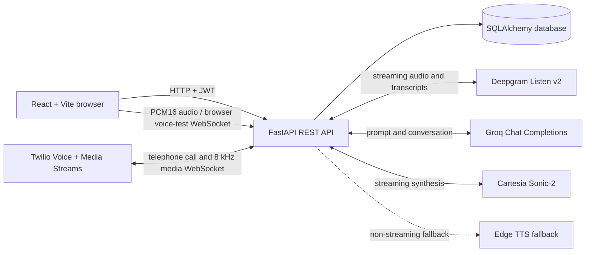

# Voiceforge — Voice AI Agent Platform

Voiceforge is a web application for configuring voice agents, managing workspaces and phone numbers, initiating and reviewing calls, and testing live voice conversations in a browser. Its backend connects the application to language-model, speech, and telephony providers.

> **Implementation note:** The default chat model is `openai/gpt-oss-20b`, requested through the Groq API. “OpenAI” in that model identifier does not mean the backend calls OpenAI directly. Agent records may specify a different model supported by the configured Groq account.

## Contents

- [Features](#features)
- [Technology](#technology)
- [Architecture](#architecture)
- [Voice and model pipeline](#voice-and-model-pipeline)
- [Data model and persistence](#data-model-and-persistence)
- [Configuration](#configuration)
- [Run locally](#run-locally)
- [API overview](#api-overview)
- [Project structure](#project-structure)
- [Development checks](#development-checks)
- [Operational notes](#operational-notes)

## Features

- User registration and login, JWT authentication, account profile management, and workspace-scoped records.
- Agent configuration, including a system prompt, Groq model ID, temperature, Cartesia voice, and speech speed.
- Optional TXT and PDF knowledge-base uploads associated with agents.
- Cartesia voice discovery, filtering, synchronization, and audio previews.
- Call history, transcripts, sentiment labels, durations, and local recording files.
- Twilio inbound and outbound calling with a real-time media stream.
- Browser-based live voice testing using a microphone, streaming transcription, and synthesized audio.
- Analytics and usage-related API modules.
- API-key authentication and rate-limited endpoints.

## Technology

| Area | Implementation |
|---|---|
| Frontend | React 19, Vite 8, React Router, Tailwind CSS, Recharts, Lucide icons |
| Backend | Python, FastAPI, Uvicorn, Pydantic |
| Persistence | SQLAlchemy ORM, Alembic migrations; SQLite by default, configurable with `DATABASE_URL` |
| LLM | Groq Chat Completions API; default model ID `openai/gpt-oss-20b` |
| STT | Deepgram streaming Listen v2; model `flux-general-en` |
| Primary TTS | Cartesia WebSocket TTS; model `sonic-2` |
| TTS fallback | Microsoft Edge TTS (`edge-tts`) for the backend's non-streaming synthesis path |
| Telephony | Twilio Programmable Voice and Media Streams |

## Architecture

The application has three main runtime layers:

1. **React web client (`frontend/`)** renders the dashboard and communicates with the API over HTTP. Authenticated requests attach the JWT as a bearer token. The live browser voice test also opens a WebSocket for microphone audio, transcripts, and generated speech.
2. **FastAPI application (`backend/app/`)** validates requests and credentials, applies workspace scoping, coordinates the voice pipeline, and uses SQLAlchemy services to read and write records.
3. **External providers** perform model inference, speech recognition/synthesis, and telephone calling: Groq, Deepgram, Cartesia, and Twilio.



### Backend layers

- **`app/main.py`** creates the FastAPI application, registers routers, sets local-development CORS origins, and configures validation, database, rate-limit, and unexpected-error responses.
- **`app/api/`** contains HTTP and WebSocket entry points. Routers are organized around authentication, agents, calls, telephony, phone numbers, voices, workspaces, API keys, knowledge-base documents, browser voice testing, and WebSockets.
- **`app/core/`** contains shared runtime concerns: JWT and API-key security, settings, rate limiting, call pre-warming, separate Deepgram clients for telephony and browser audio, and the LLM/TTS pipeline.
- **`app/services/`** contains domain operations such as account registration, agent and call persistence, knowledge-base extraction, Cartesia voice access/synchronization, and phone-number/workspace operations.
- **`app/models/`** defines SQLAlchemy entities. **`app/schemas/`** defines request and response validation models.
- **`backend/alembic/`** contains database migration configuration and revisions.

### Frontend layers

- **`src/App.jsx`** defines public login/registration routes and the authenticated application layout.
- **`src/components/`** contains shared navigation, profile/header, and UI components.
- **`src/pages/`** contains dashboard, agent, call, analytics, settings, and voice-testing screens.
- **`src/services/api.js`** configures the Axios client, API base URL, bearer token, and redirect after an HTTP 401 response.
- **`src/services/voice.js`** provides voice-related client operations.

### Authentication and workspace boundaries

Registration and login issue a signed JWT containing the user and workspace IDs. Protected endpoints accept JWT bearer-token authentication; the security dependency also supports an `X-API-Key` credential. Services and route handlers use the authenticated workspace ID to scope records such as agents and calls. Passwords are hashed with bcrypt before persistence.

### Knowledge-base handling

TXT and PDF uploads are validated and converted to text by `knowledge_base_service.py` (up to 5 MB per file). The extracted text is stored in the relational database. When a voice session loads an agent, the backend fetches up to the three most recently created knowledge-base entries for that agent and appends their content to the system prompt. The pipeline limits this knowledge context to 1,500 characters.

This is **not** a vector-search or embedding-based retrieval system: the current implementation selects recent documents and includes their text directly in the prompt.

## Voice and model pipeline

### Which LLM is used?

The default model ID is **`openai/gpt-oss-20b`**, called using the **Groq Python SDK** and Groq's Chat Completions API. The `openai/` portion is part of the model ID; it does not indicate that the app uses the OpenAI API.

- New agents are initialized with this model ID in the frontend.
- The backend reads the model ID from the agent record and falls back to `openai/gpt-oss-20b` if it is missing.
- The agent model and temperature are passed into the voice pipeline. Temperature is clamped to the supported range `0.0`–`2.0`.
- For GPT-OSS model IDs, the pipeline requests up to 128 completion tokens, low reasoning effort, and no reasoning payload. It has a compatibility fallback for Groq SDK versions that reject those GPT-OSS-specific arguments.
- Two retired Llama model IDs are mapped to `openai/gpt-oss-20b` in the call and browser voice-session initialization paths.
- Call-end sentiment classification also uses `openai/gpt-oss-20b` through Groq, with temperature `0`.
- The default system prompt is tuned for short, natural spoken replies. Up to the last six conversation messages are included as conversation history.

The model must be enabled for the Groq account associated with `GROQ_API_KEY`. If changing a model, use a model identifier supported by the account and API.

### Speech-to-text (STT)

STT is handled by **Deepgram Listen v2** with the streaming model **`flux-general-en`**. The browser and telephone paths use separate clients because their audio formats differ.

#### Telephone calls

1. Twilio sends the call's inbound media to the backend WebSocket at `/ws/call`.
2. The media payload is base64-decoded and forwarded to Deepgram as **8 kHz, μ-law** audio (`encoding="mulaw"`, `sample_rate=8000`).
3. Deepgram streams turn events and transcription text back to the backend. The call handler filters duplicate/partial events and uses the eager end-of-turn event to start a response; user speech can interrupt a response already being played.
4. The backend pre-warms a Deepgram connection while Twilio plays the initial greeting, then reuses that connection when the media WebSocket starts where possible.

#### Browser voice testing

1. The browser requests microphone access and captures mono audio through the Web Audio API.
2. Float audio samples are converted to signed **16-bit linear PCM** and sent as binary WebSocket frames at the configured **16 kHz** audio-context rate.
3. The browser WebSocket endpoint forwards the frames to Deepgram as `encoding="linear16"`, `sample_rate=16000`.
4. Completed user turns are sent to the frontend as transcript events and passed to the response pipeline.

### Text-to-speech (TTS)

The primary TTS provider is **Cartesia**, using its WebSocket API and **`sonic-2`** model. Agents select a Cartesia voice ID and can set a speech-speed preference. The backend maps the numeric speed setting to Cartesia's discrete `slowest`, `slow`, `normal`, `fast`, or `fastest` controls.

- **Telephony:** Cartesia generates raw mono PCM16 audio at 8 kHz. The backend converts it to μ-law and sends base64-encoded audio frames back to Twilio. Responses are generated and synthesized a sentence at a time, so playback can begin before the full answer is generated.
- **Browser testing:** Cartesia audio chunks are returned as base64-encoded PCM16 8 kHz audio. The browser decodes and schedules those chunks for playback.
- **Voice previews:** the voice-preview endpoint uses Cartesia `sonic-2` and returns a WAV response.
- **Fallback:** `_synthesize()` can use Edge TTS with `en-US-AriaNeural` when Cartesia is unavailable or synthesis fails, converting the result to 8 kHz mono μ-law. This fallback applies to the pipeline's non-streaming synthesis path; the current live streaming paths use Cartesia streaming directly.

### End-to-end conversation paths

#### Twilio call

1. The authenticated client requests an outbound call, or a Twilio number receives an inbound call.
2. The backend creates or locates a workspace-scoped call record and returns TwiML that plays an initial greeting and starts a Twilio Media Stream.
3. The `/ws/call` WebSocket receives Twilio events and audio; the start event's custom call parameters associate the stream with its call record.
4. Deepgram transcribes the incoming audio and signals the end of a user turn.
5. The backend loads that call's agent settings and recent knowledge-base text, calls Groq with the prompt and recent conversation, and streams sentence-sized text chunks.
6. Cartesia synthesizes each sentence. The backend converts audio to the Twilio stream format and sends it back. A new user turn can cancel current generation/playback.
7. When the call ends, the backend writes a WAV recording under `backend/recordings/` (relative to the backend process working directory), builds a transcript from the conversation, classifies sentiment, and updates the call record.

#### Browser voice test

1. The authenticated browser asks for a short-lived voice-test session token for a selected agent.
2. The browser opens `/api/voice-test/ws` with that token and streams microphone audio.
3. The backend validates the session, loads the agent and up to three recent knowledge-base entries, then starts the 16 kHz Deepgram client.
4. Completed transcript turns enter the same Groq response generation pipeline. Sentence text and Cartesia audio chunks are streamed to the browser.
5. The browser displays the transcript and plays incoming audio. The voice-test token expires after five minutes and is consumed when the WebSocket initializes.

## Data model and persistence

The primary entities are:

- **Workspace:** tenant boundary for users, agents, calls, phone numbers, and knowledge-base entries.
- **User:** workspace member with profile details and a hashed password.
- **Agent:** system prompt, model ID, language, Cartesia voice ID, temperature, and voice speed.
- **Call:** agent/workspace association, phone number, direction, status, timestamps, duration, transcript, sentiment, Twilio SID, and recording path.
- **Phone number:** a Twilio number assigned to a workspace and agent.
- **Knowledge base:** extracted TXT/PDF content associated with a workspace and optionally an agent.
- **Voice:** synchronized provider voice metadata used by the UI and agent configuration.
- **API key / usage record:** API credentials and usage-related persistence.

The default database is SQLite at `backend/voiceforge.db` when commands run from the `backend/` directory. `DATABASE_URL` can point to another SQLAlchemy-supported database. Apply schema changes with Alembic before starting the API:

```shell
alembic upgrade head
```

## Configuration

Copy [`backend/.env.example`](backend/.env.example) to `backend/.env` and set real credentials there. Keep `.env` files out of version control and never commit provider keys.

| Variable | Required | Purpose |
|---|---:|---|
| `JWT_SECRET_KEY` | Yes | Signs and verifies access tokens. Use a long, random secret. |
| `GROQ_API_KEY` | Yes for voice responses | Authenticates LLM completions and call-end sentiment classification. |
| `DEEPGRAM_API_KEY` | Yes for voice input | Authenticates live speech recognition. |
| `CARTESIA_API_KEY` | Yes for Cartesia voices/streaming | Authenticates voice discovery, previews, and live TTS. The backend has limited Edge TTS fallback behavior when Cartesia is unavailable. |
| `DATABASE_URL` | No | SQLAlchemy URL; defaults to `sqlite:///./voiceforge.db`. |
| `JWT_ALGORITHM` | No | JWT signing algorithm; defaults to `HS256`. |
| `JWT_EXPIRE_MINUTES` | No | JWT lifetime; defaults to `1440` minutes. |
| `TWILIO_ACCOUNT_SID` | For telephony | Twilio account SID. |
| `TWILIO_AUTH_TOKEN` | For telephony | Twilio authentication token. |
| `TWILIO_PHONE_NUMBER` | For telephony | Twilio number used to originate calls. |
| `PUBLIC_BASE_URL` | For telephony | Public HTTPS base URL for Twilio webhooks and media streams. |
| `VITE_API_URL` | No | Frontend API base URL; defaults to `http://localhost:8000`. |

Generate a signing secret locally instead of reusing an example value:

```shell
python -c "import secrets; print(secrets.token_urlsafe(32))"
```

Set the generated output as `JWT_SECRET_KEY` in `backend/.env`.

## Run locally

### Requirements

- Python 3.11 or newer
- Node.js `^20.19.0` or `>=22.12.0` (Vite 8 requirement in the lockfile)
- npm
- Provider credentials for the voice features you intend to run

### 1. Configure the backend

From the repository root, copy `backend/.env.example` to `backend/.env`, generate a `JWT_SECRET_KEY`, then add the applicable provider keys.

**Windows PowerShell:**

```powershell
Copy-Item backend\.env.example backend\.env
```

**macOS / Linux:**

```shell
cp backend/.env.example backend/.env
```

### 2. Install and start the backend

**Windows PowerShell:**

```powershell
cd backend
py -3.11 -m venv .venv
.\.venv\Scripts\Activate.ps1
python -m pip install -r requirements.txt
alembic upgrade head
uvicorn app.main:app --reload
```

**macOS / Linux:**

```shell
cd backend
python3 -m venv .venv
source .venv/bin/activate
python -m pip install -r requirements.txt
alembic upgrade head
uvicorn app.main:app --reload
```

The API is available at `http://localhost:8000`. Interactive OpenAPI documentation is at `http://localhost:8000/docs`; the health endpoint is `http://localhost:8000/health`.

### 3. Install and start the frontend

In a second terminal:

```shell
cd frontend
npm ci
npm run dev
```

Vite prints the local frontend URL, normally `http://localhost:5173`. If the API is hosted somewhere else, set `VITE_API_URL` in the frontend environment before starting Vite.

### 4. Configure telephony (optional)

Set the Twilio credentials and `PUBLIC_BASE_URL` in `backend/.env`. Twilio must be able to reach the public HTTPS webhook and WebSocket endpoints. Assign an appropriate Twilio phone number to an agent in the application before placing outbound calls. Localhost is not reachable by Twilio.

## API overview

FastAPI publishes the full request/response contract at `/docs`. Main route groups include:

| Prefix / path | Purpose |
|---|---|
| `/auth` | Registration, login, current profile, profile updates, account deletion |
| `/agents` | Workspace-scoped agent creation, listing, update, and deletion |
| `/calls` | Call record creation, listing, retrieval, update, and deletion |
| `/twilio` | Twilio inbound-call webhook and outbound-call initiation |
| `/ws/call` | WebSocket used by Twilio Media Streams |
| `/api/voice-test` | Browser voice-test session creation and WebSocket |
| `/voices` | Provider voice listing, preview, and synchronization |
| `/knowledge-base` | Upload, list, retrieve, and delete knowledge-base entries |
| `/phone-numbers` | Workspace phone-number management |
| `/workspaces` | Workspace operations |
| `/api-keys` | API-key management |

Most REST operations require JWT or API-key authentication. The Twilio webhook and media-stream URLs must be reachable by Twilio and are separate from browser-authenticated dashboard requests.

`backend/app/api/analytics.py` defines an `/analytics/calls` endpoint, but that router is not currently registered by `app/main.py`. The frontend analytics page currently derives its charts and summary metrics from the calls and agents it fetches.

## Project structure

```text
Voice-Agent-Platform/
├── backend/
│   ├── alembic/                 # Migration environment and revisions
│   ├── app/
│   │   ├── api/                 # HTTP routes and WebSocket endpoints
│   │   ├── core/                # Security, settings, STT and voice pipeline
│   │   ├── models/              # SQLAlchemy entities
│   │   ├── schemas/             # Pydantic request/response schemas
│   │   ├── services/            # Persistence and provider/domain services
│   │   ├── database.py          # Engine, sessions and DB dependencies
│   │   └── main.py              # FastAPI app and router registration
│   ├── requirements.txt
│   └── .env.example
├── frontend/
│   ├── public/                  # Static assets
│   ├── src/
│   │   ├── components/          # Shared application components
│   │   ├── lib/                 # Frontend utilities
│   │   ├── pages/               # Dashboard and product screens
│   │   ├── services/            # HTTP and voice API clients
│   │   ├── App.jsx              # Routes and authenticated layout
│   │   └── index.css            # Global styles and design system
│   ├── package.json
│   └── vite.config.js
└── README.md
```

## Development checks

Frontend:

```shell
cd frontend
npm run lint
npm run build
```

Backend smoke tests and scripts are in `backend/`; check each script's requirements and run it from that directory with the backend virtual environment activated.

## Operational notes

- `backend/app/main.py` currently allows browser CORS origins `http://localhost:5173` and `http://localhost:5174`. Update the allowlist before serving the frontend from another origin.
- The browser voice-test page currently constructs its WebSocket URL using `localhost:8000`; it is intended for local development unless that endpoint is changed for another deployment.
- The backend saves telephone recordings to local disk under `recordings/` (relative to the backend process working directory). The current implementation does not upload those recording files to object storage.
- The initial Twilio greeting is generated with TwiML `<Say>`; interactive replies use the configured TTS pipeline.
- The repository does not define a hosting provider or deployment workflow. Configure and verify deployment infrastructure separately rather than assuming a specific hosting service.
